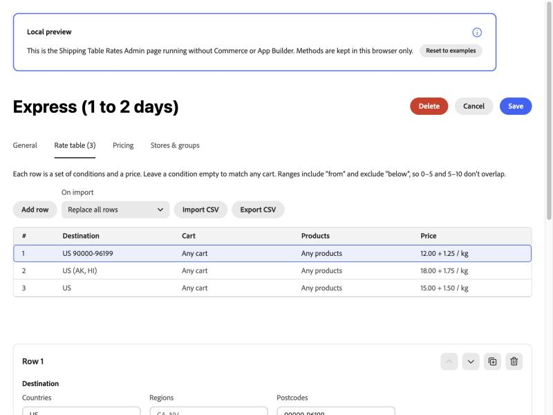
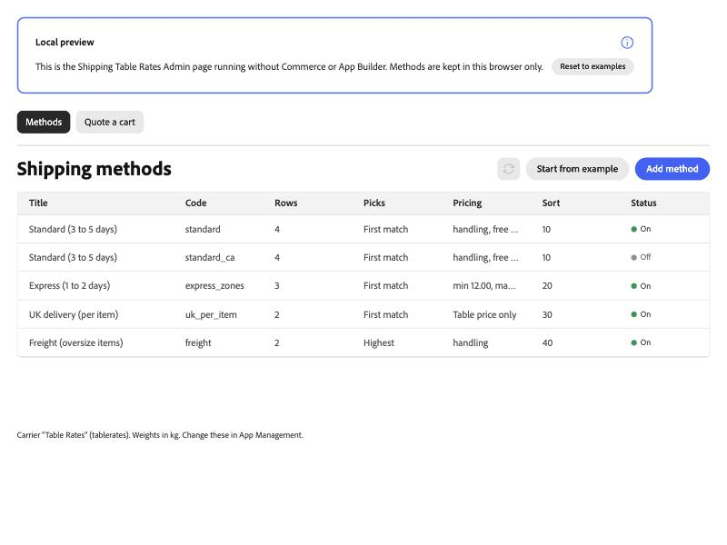
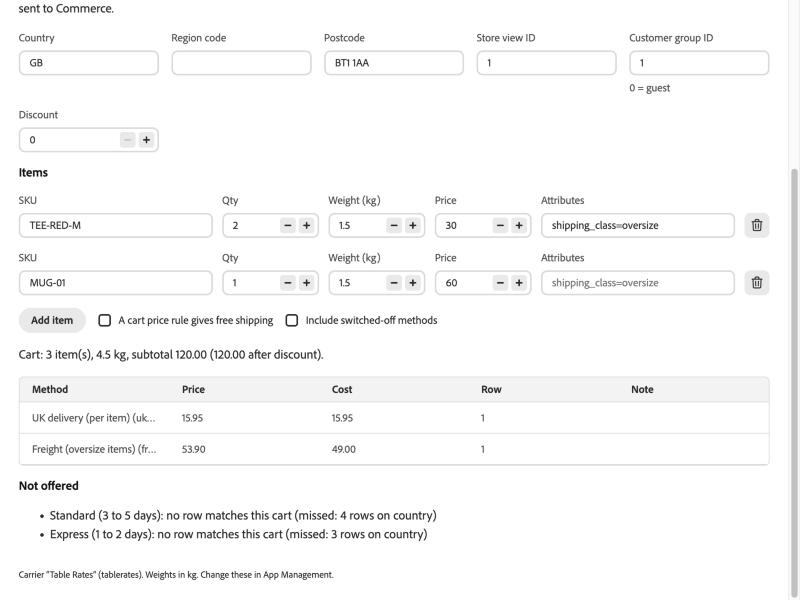

# Shipping Table Rates for Adobe Commerce

[](https://github.com/sohelrana09/commerce-shipping-table-rates/actions/workflows/ci.yml)
[](https://developer.adobe.com/app-builder/)
[](https://business.adobe.com/products/commerce.html)
[](https://nodejs.org/)
[](https://react-spectrum.adobe.com/)
[](https://github.com/sohelrana09/commerce-shipping-table-rates)
[](LICENSE)

**Table rate shipping for Adobe Commerce, built as an App Builder app.**

Built by [Sohel Rana](https://sohelrana.io), Adobe Certified Master Architect and Claude Certified Architect – Foundations (CCAR-F).

[Quick start](#quick-start) · [Screenshots](#screenshots) · [Rate tables](docs/rate-tables.md) · [Webhook](docs/webhook.md) · [Contributing](CONTRIBUTING.md)

Shipping Table Rates lets merchants define their own shipping methods and price them from rate tables: by **country, region and postcode** (exact codes, wildcards and ranges), **cart weight**, **subtotal**, **item quantity**, and **SKU or product attribute**. A row can charge per order, per item, per weight unit and a percent of the subtotal, and each method adds **handling fees**, **minimum and maximum prices** and a **free shipping threshold**.

It replaces the table rate shipping PHP modules merchants used on Magento, and it runs **out of process**: Commerce asks the app for rates through the out-of-process shipping method webhook. So it works on **Adobe Commerce as a Cloud Service (SaaS)**, where PHP modules can't be installed, as well as on Adobe Commerce on cloud infrastructure and on-premises (PaaS).

**Key features**

- **Rate tables that read like a spreadsheet:** one row per zone and band, with CSV import and export, and Magento table rate column names accepted on import.
- **Precise destinations:** country, region code or ID, and postcodes as exact codes (`10001`), wildcards (`SW1*`), ranges (`90000-96199`) and exclusions (`!BT*`).
- **Every pricing model:** per order, per item, per weight unit (with a rounding step such as 0.5 kg) and percent of subtotal, combined in one row.
- **Method rules:** first, cheapest or most expensive matching row; handling fee and percent; minimum and maximum; free from a subtotal; free when a cart price rule says so; store views and customer groups.
- **Quote a cart:** test any cart in the Admin and see each method's price, the row that priced it, and why the others weren't offered.
- **Signed and fail-safe:** the webhook verifies Commerce's signature, and if anything breaks it offers a fallback rate (or nothing) instead of breaking checkout.



---

## Contents

- [Who it is for](#who-it-is-for)
- [What shoppers see](#what-shoppers-see)
- [What you manage as a merchant](#what-you-manage-as-a-merchant)
- [Screenshots](#screenshots)
- [How it works](#how-it-works)
- [Quick start](#quick-start)
- [Configuration](#configuration)
- [Commands](#commands)
- [Project structure](#project-structure)
- [Roadmap](#roadmap)
- [FAQ](#faq)
- [Contributing](#contributing)

## Who it is for

- **Merchants** moving to Adobe Commerce as a Cloud Service who priced shipping with a Magento table rate module, and need the same rates on SaaS.
- **Agencies and developers** who need a reference build: a signed out-of-process shipping webhook, an Admin UI SDK page, App Management settings and install steps, and App Builder Database Storage, in one small, tested app.
- **Operations teams** who keep carrier price lists in spreadsheets and want to load them as CSV instead of retyping them.

## What shoppers see

| Feature | What it means in practice |
|---|---|
| **Your own methods at checkout** | "Standard (3 to 5 days)", "Express", "Freight" or anything you name, under one carrier title you choose, next to the store's other carriers. |
| **Prices that fit the cart** | Heavier carts, remote postcodes and oversize products cost what you decided, worked out from the address and cart Commerce sends. |
| **Free shipping when promised** | Free from a subtotal you set, or when a cart price rule gives free shipping. |
| **Checkout that keeps working** | If the app can't be reached or a table is broken, checkout still shows the store's other carriers, and a fallback rate if you set one. |

## What you manage as a merchant

Everything is in the Commerce Admin. There is nothing to deploy when prices change.

| You want to... | Where |
|---|---|
| Add, change or remove a shipping method | **Shipping Table Rates** in the Admin menu. Start from an example (weight bands, express zones, UK per item, freight) or from scratch. |
| Load a carrier's price list | The method's **Rate table → Import CSV**, replacing the table or adding to it. **Export CSV** gives you the table back. |
| Check a price before shoppers see it | **Quote a cart**: describe an address and items, and see every method's price and why others don't apply. |
| Offer a method in one store view or to trade customers only | The method's **Stores & groups**. |
| Switch every method off, rename the carrier, or set a fallback rate | **Apps → App Management → Shipping Table Rates → Configure**. |
| Keep methods in version control | `SHIPPING_METHODS` in `.env` (see [Configuration](#configuration)). |

## Screenshots

| Methods | Quote a cart |
|---|---|
|  |  |

All screenshots come from the local Admin preview (`npm run admin:preview`).

## How it works

```
Commerce Admin ──> Shipping Table Rates page (Admin UI SDK, React Spectrum 2)
                     │  IMS sign-in            └─ CSV import/export and "Quote a cart" run in the browser
                     v
               App Builder (I/O Runtime) ──> App Builder Database Storage (shipping_methods)
                     ^                                   │
                     │ signed webhook: rateRequest       │ cached 30 s per warm container
                     │ <── add "result" per method ──────┘
Checkout ──> Adobe Commerce: out-of-process shipping methods (carrier "tablerates")
```

Key design choices:

- **One engine.** [`src/common/rates/engine.js`](src/common/rates/engine.js) has no dependencies and is shared by the webhook, the Admin actions and the Admin page (as `#engine`), so **Quote a cart** gives the same price as checkout.
- **The cart Commerce sends is enough.** Weight, quantity, subtotal, destination and item SKUs and attributes all arrive in the webhook's `rateRequest`, so pricing needs no calls back to Commerce.
- **Signed, then fail-safe.** Unsigned requests get a 401 and no rates. Once a request is verified, no error can break checkout: the webhook answers with the fallback rate or with no table rates.
- **Rate tables live with the method.** One document per method keeps a save atomic and a read cheap; a method holds up to 5,000 rows.
- **No lock-in.** Plain App Builder, the Admin UI SDK and a CSV format any spreadsheet opens.

More in [docs/architecture.md](docs/architecture.md).

## Quick start

**You need:** Node.js 24 (`.nvmrc` pins it), the Adobe I/O CLI (`npm install -g @adobe/aio-cli`), an App Builder project in the same Adobe organization as your Commerce instance, and Commerce with the Out-of-Process Shipping Methods module (built into Adobe Commerce as a Cloud Service).

1. **Clone and install**

   ```bash
   git clone https://github.com/sohelrana09/commerce-shipping-table-rates.git
   cd commerce-shipping-table-rates
   npm install
   npm test
   ```

2. **Try the Admin page locally (optional)**

   ```bash
   npm run admin:preview
   ```

   Open http://localhost:4344/preview.html. It is the real Admin page (methods, rate table editor, CSV import and export, and **Quote a cart**), with methods kept in your browser's local storage and seeded with the examples. **Reset to examples** starts over. No Commerce or Adobe account needed.

3. **Deploy**

   In the [Adobe Developer Console](https://developer.adobe.com/console), add **I/O Management API**, **App Builder Data Services** and an **OAuth Server-to-Server** credential to the workspace. Then:

   ```bash
   aio login
   aio app use --merge
   cp env.dist .env
   aio app deploy
   ```

4. **Turn on webhook signatures in Commerce**

   In the Commerce Admin, open **Stores → Settings → Configuration → Adobe Services → Webhooks**, enable **Digital Signature Configuration** and choose **Regenerate key pair**. Copy the public key: App Management asks for it as **Commerce webhook public key** (or set `COMMERCE_WEBHOOK_PUBLIC_KEY` in `.env` and redeploy).

5. **Install in Commerce**

   Open **Apps → App Management**, install **Shipping Table Rates**, and give its ACL resource to the admin roles that manage shipping. Installation creates the database, registers the `tablerates` carrier and subscribes the shipping webhook. Open **Shipping Table Rates**, start from an example, switch it on, and try it with **Quote a cart**.

   <details>
   <summary>Keeping methods in code instead</summary>

   Put the methods as a JSON array in `SHIPPING_METHODS` in `.env` (format: [docs/rate-tables.md](docs/rate-tables.md)) and run `aio app deploy`. While it is set, the webhook uses those methods and ignores the Admin page.

   </details>

The full guide, with settings, data and troubleshooting, is [docs/installation.md](docs/installation.md).

## Configuration

**App Management** (Apps → App Management → Shipping Table Rates → Configure):

| Setting | Purpose |
|---|---|
| Offer table rates at checkout | The master switch (on by default). Off: the webhook adds no methods. |
| Carrier code | The out-of-process carrier the methods belong to (default `tablerates`). Must match the registered carrier. |
| Carrier title | The carrier name shoppers see (default "Table Rates"). |
| Weight unit | `kg` or `lbs`, to label the Admin page. Use the store's own weight unit. |
| Fallback price | Offered as one method when the rate tables can't be read. Empty (default): offer nothing. |
| Fallback method title | The fallback method's title (default "Standard shipping"). |

**Environment** (`.env`, never commit it; `env.dist` lists every variable):

| Variable | Purpose |
|---|---|
| `LOG_LEVEL` | `debug`, `info` (default), `warn` or `error`. |
| `COMMERCE_WEBHOOK_PUBLIC_KEY` | The PEM public key from Commerce's webhook signature settings. Without it, the webhook rejects every request. |
| `SHIPPING_METHODS` | Optional. A JSON array of methods; when set, the webhook uses these instead of the Admin page's. |

## Commands

| Command | What it does |
|---|---|
| `npm test` | Unit tests with coverage (Vitest). No Adobe account needed: the database, Commerce, signatures and I/O Runtime are faked. |
| `npm run code:check` / `npm run code:fix` | Biome lint and format. |
| `npm run typecheck` | TypeScript check of the Admin page, against the engine's type declarations. |
| `npm run admin:preview` | The Admin page with an in-browser store, at http://localhost:4344/preview.html. `PORT` changes the port. |
| `aio app dev` | The Admin page locally, against the workspace's actions. |
| `aio app build` / `aio app deploy` | Build, or build and deploy to the selected workspace. |

## Project structure

```
app.commerce.config.ts       App Management: Admin menu, settings, install steps, webhooks
src/common/rates/
    engine.js                the rate engine, shared by everything (imported as #engine)
    csv.js                   rate table CSV import and export (imported as #csv)
    signature.js             Commerce webhook signature check
    methods-repo.js, db.js   App Builder Database Storage
    settings.js, sources.js  App Management settings, and where methods come from
    carrier.js               out-of-process carrier registration
src/commerce-extensibility-1/
    actions/shipping-rates/  the shipping method webhook
src/commerce-backend-ui-2/
    actions/                 Admin actions: methods-list, method-save, method-delete, lookups
    web-src/                 the Admin page (React Spectrum 2)
scripts/setup-database.js    install step: database and indexes
scripts/register-carrier.js  install step: the Commerce carrier
scripts/admin-preview.js     local Admin page preview (Parcel)
docs/                        guides and screenshots
test/                        unit tests
```

## Roadmap

Done: rate engine with destination, postcode range and wildcard, weight, subtotal, quantity, SKU and attribute conditions; per order, item, weight unit and percent pricing; first, cheapest and highest row selection; handling, minimum, maximum and free shipping; signed, fail-safe shipping webhook with a fallback rate; Admin page with examples, rate table editor, CSV import and export, and **Quote a cart**; App Management settings, database and carrier install steps; methods in code; local Admin preview; unit tests at 98% coverage.

Next:
- Install and check on a live Adobe Commerce as a Cloud Service instance, then submit to the Adobe Commerce Marketplace.
- Rates per item group (price oversize items on one row and the rest on another, then add them).
- Delivery estimates ("arrives Tuesday") in the method title.
- Volumetric weight from product dimensions.

Ideas and pull requests are welcome, see [Contributing](#contributing).

## FAQ

**Is this an official Adobe product?**
No. Shipping Table Rates is an independent open-source project. Adobe, Adobe Commerce and App Builder are trademarks of Adobe.

**Does it slow checkout down?**
Rarely. Pricing is a few milliseconds of JavaScript, and methods are cached in each warm action container for 30 seconds. The webhook has a 1 second soft timeout and a 5 second hard timeout, and it isn't required: if it's slow, checkout carries on with the other carriers.

**Can I import my Magento table rates CSV?**
Yes. The importer accepts Magento's `dest_country`, `dest_region`, `dest_zip` and `price` headers next to its own columns. Magento's condition column (weight vs destination, etc.) maps to `weight_from` or `subtotal_from`; see [docs/rate-tables.md](docs/rate-tables.md#csv).

**Why does the webhook reject my test request?**
It accepts only requests signed by Commerce. Turn on webhook signatures in Commerce and set the public key, see [docs/webhook.md](docs/webhook.md#signatures).

**Which subtotal do conditions use?**
Before discounts, unless a method says **After discounts**. Free shipping thresholds and percent prices use the same subtotal.

**Is it production-ready?**
It is unit tested and its Admin page has been checked in a local preview, but it hasn't been installed on a live Commerce instance yet. Before going live:
- install it on a Stage workspace and instance first, and check the carrier, the webhook subscription and a real checkout;
- confirm the webhook method names with `GET /V1/webhooks/supportedList` on your instance;
- quote your busiest carts with **Quote a cart** and compare them with your current rates.

## Contributing

Bug fixes, new conditions, pricing options and better documentation are all welcome. For larger changes, open an issue first so we can agree on the approach.

1. Fork the repository and create a branch: `git checkout -b feature/your-change`.
2. Make your change, following the [project structure](#project-structure): pricing logic goes in the engine with unit tests, server-only code in `src/common/rates`, and actions stay thin.
3. Run the checks: `npm run code:check`, `npm run typecheck` and `npm test`, plus `npm run admin:preview` for anything on the Admin page.
4. Commit, push the branch and open a pull request that says what changed and how you tested it.

The full guide is in [CONTRIBUTING.md](CONTRIBUTING.md). Please report security problems privately, see [SECURITY.md](SECURITY.md), and follow the [code of conduct](CODE_OF_CONDUCT.md).

## License

[MIT](LICENSE). You may use, change and redistribute Shipping Table Rates, also in commercial projects, as long as the copyright notice stays.

---

Made with Adobe App Builder. If Shipping Table Rates helps you, please give it a star.
